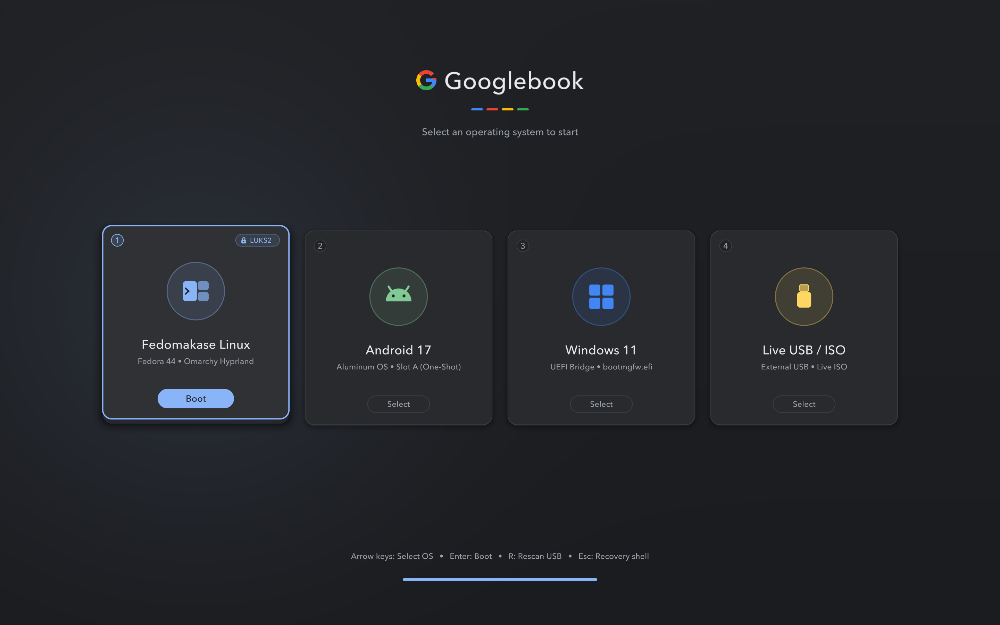
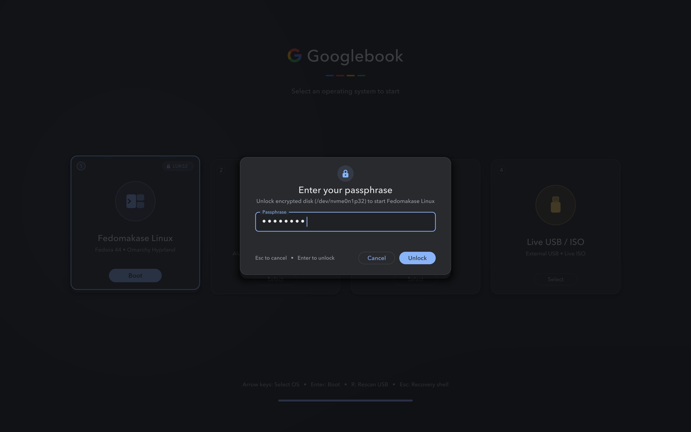

# `googleboot-menu` — Graphical DRM/KMS + `kexec` Boot Menu

`googleboot-menu` turns the Acer Googlebook 14 (`Moonstone`) Slot B partitions (`boot_b` + `init_boot_b` + `vendor_boot_b`) into a permanent, graphically customizable **Petitboot-style `kexec` bootloader** running at the full **`2880x1800` OLED** resolution via `framebuffer-coreboot.ko` + `simpledrm`.





---

## Key Features

1. **Zero External GUI Library Bloat (~65 KB Binary)**:
   - Written in self-contained C (`src/googleboot-menu.c`) using raw Linux kernel DRM/KMS dumb-buffer ioctls (`/dev/dri/card0`), Signed Distance Field (SDF) anti-aliased rounded cards, radial lighting, and `evdev` (`/dev/input/event*`) input.
   - Requires only `libc`, `libm`, and `libz`—adding `< 70 KB` to the `32 MiB` `vendor_boot_b` ramdisk.
2. **Instant Local Graphical Theme Preview (`make preview`)**:
   - Compiles natively on both **macOS** and **Linux**.
   - Edit [`theme/theme.conf`](theme/theme.conf) and run `make preview` to render `2880x1800` PNG previews (`theme/preview-main.png` and `theme/preview-luks.png`) in under 200ms without rebooting.
   - On the laptop, `googleboot-menu` reads `/boot/googlebook-theme/theme.conf` live from `nvme0n1p11` (`linux_boot`), when that filesystem is available at `/boot`; the initramfs also contains the theme copied at build time. Rebuild Slot B to update that copy.
3. **Petitboot-Style OS Discovery (`bin/googleboot-scan`)**:
   - **Installed Linux Distros**: Automatically parses BootLoaderSpec (`/boot/loader/entries/*.conf`) and `/boot/vmlinuz-*` on `nvme0n1p11`, unlocks LUKS2 (`nvme0n1p32`) via the graphical passphrase modal, and can load the selected kernel and initramfs through `kexec`. Each target distribution and display handoff needs validation.
   - **Android 17 (Slot A One-Shot)**: Arms Slot A with `Priority=15, Tries=1, Successful=0` while keeping Slot B (`googleboot-menu`) at `Priority=14, Successful=1`. Fallback to Linux depends on Android not marking Slot A successful again.
   - **Experimental Windows entry**: Requires a separately validated `/boot/uefi-bridge.bzImage`. The included U-Boot builder only produces an ELF research artifact; it does not implement a working Windows boot path.
   - **Live USB / ISO Hotplug (`R` to Rescan)**: Scans any plugged-in USB stick (`/dev/sd*`) for Fedora/Omarchy, Arch, or Ubuntu/Debian Live ISOs and `kexec`s directly into the live installer.

---

## Building & Previewing Themes

```bash
cd googleboot-menu
make preview
```

Outputs:
- `theme/preview-main.png` (`2880x1800`)
- `theme/preview-luks.png` (`2880x1800`)

The initramfs installer rebuilds the menu from source for the build host. The stale prebuilt Linux executable has been removed; build the target menu on Linux.
